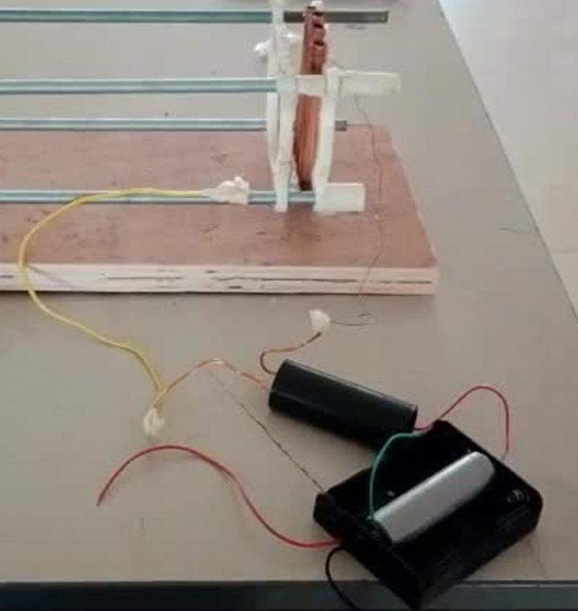
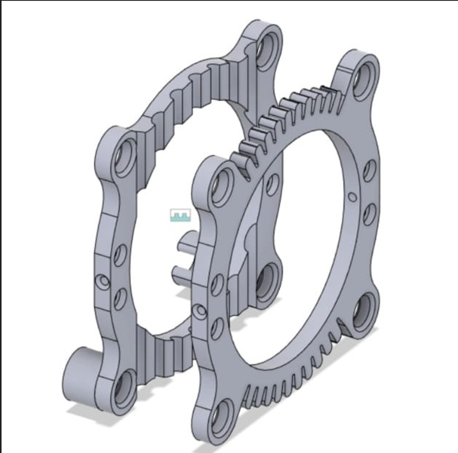
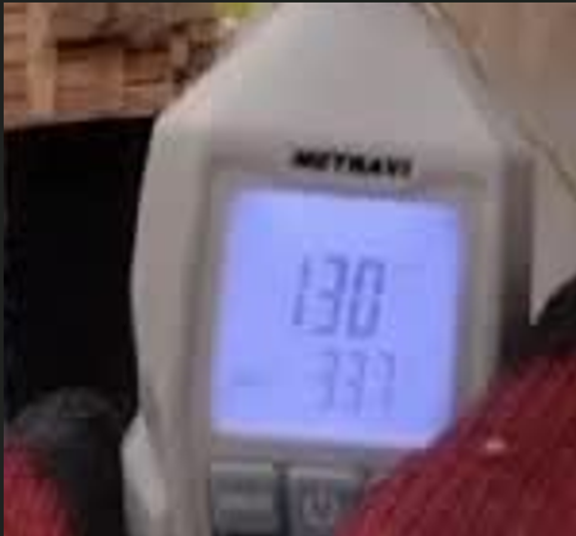
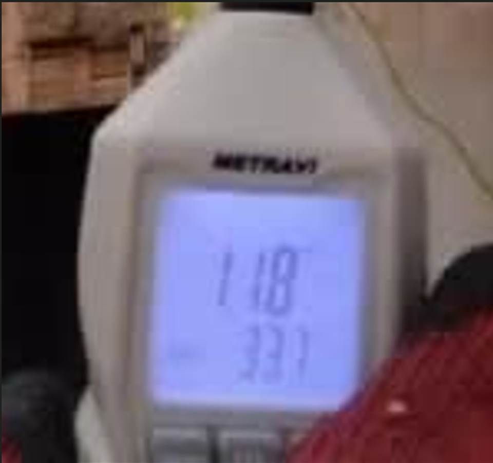
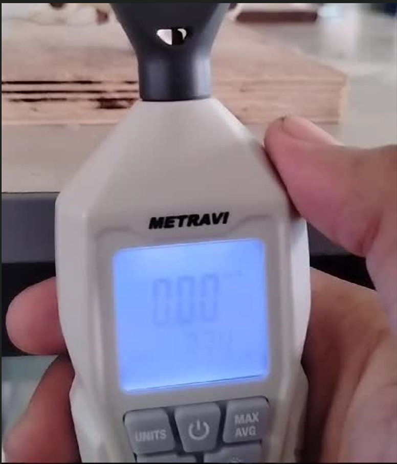
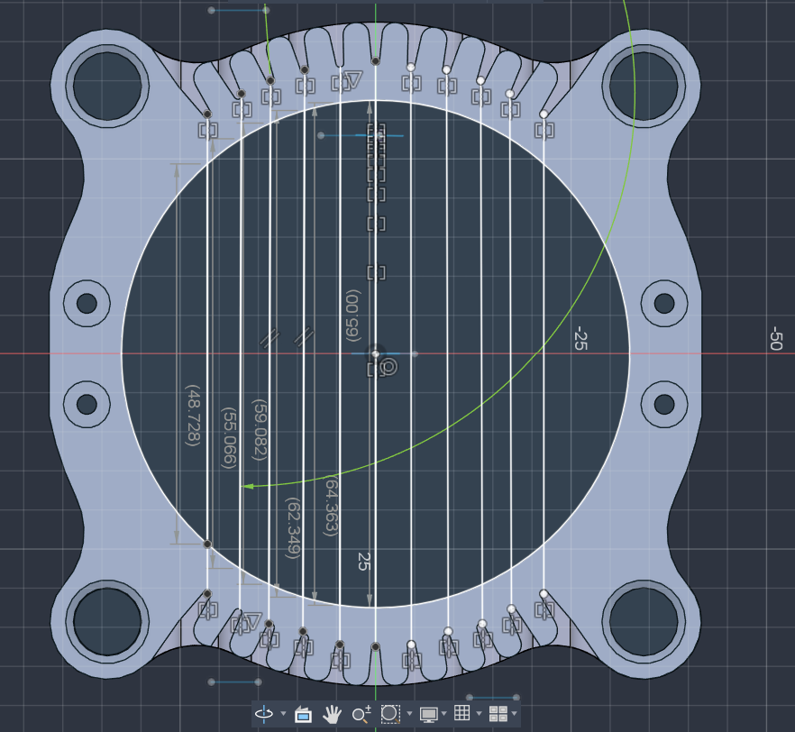
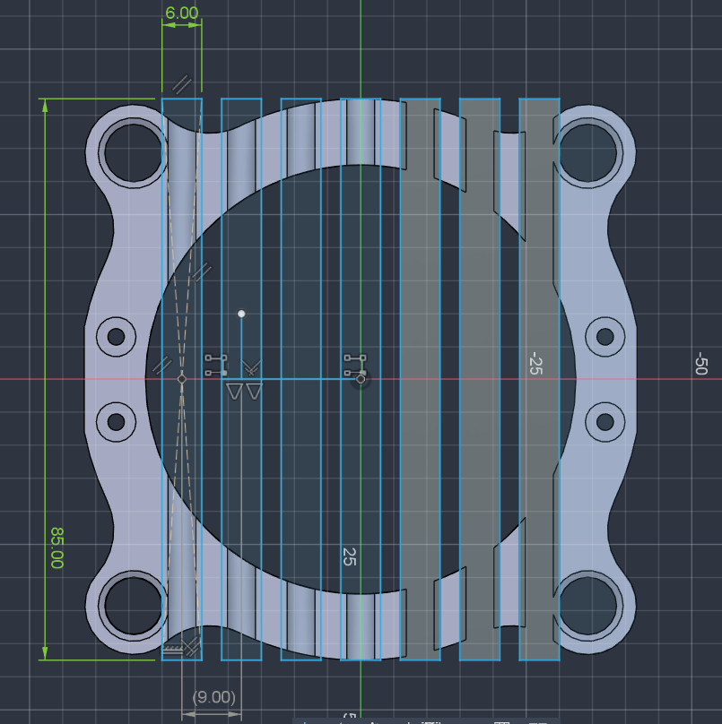

# Electrohydrodynamic (ion-wind) thruster: build and physics analysis

Built and tested in August 2023 (GITAM University, Visakhapatnam); physics analysis November 2026.

**Question:** does a model of ions drifting through air explain how this thruster behaved, and
what limited it?

**Final numbers, with sources and uncertainties: [`RESULTS.md`](RESULTS.md).**

## Layout
| path | contents |
|---|---|
| `theory.md` | derivations: corona onset (Peek), Townsend I–V, T = I·d/μ, actuator-disk jet, efficiency, Mott–Gurney vs Child–Langmuir |
| `data/geometry.json` | every input: CAD geometry, wire and tube data, test site and weather, supply, anemometer, observations |
| `data/velocity_readings.csv` | anemometer readings extracted frame by frame from the test videos |
| `infer_current.py` | first-pass estimate assuming an ideal jet (superseded by sim/ stage 3) |
| `ehd_model.py` | template for a future V–I–velocity sweep (demo only; the 2023 test had one operating point) |
| `sim/` | stage 1 electrostatics, stage 2 space charge, stage 3 OpenFOAM airflow, sensitivity checks; see `sim/README.md` |
| `sim/stage3_case_setup/ehd_coarse_case.zip` | ready-to-run OpenFOAM case (coarse mesh) with a reproduction check |
| `media/` | CAD views, photos of the build, still frames and the raw 2023 test videos (`media/videos/`) |

## The device
- **Emitter:** 11 bare copper wires, 36 AWG (0.127 mm), 4.3 mm pitch, across a 65 mm opening
  (644 mm active length), nicked with a craft knife; negative polarity (most likely; leads unmarked).
- **Collector:** 7 bare copper tubes, 6 mm OD, 9 mm pitch, front surface 11.11 mm from the wires;
  33 % of the opening left open.
- **Supply:** single 18650 cell (3.7 V at test, ~half charged) driving an unbranded "400 kV" pulsed
  module; spark-gap test gives ~11 kV peak (9–14 kV).
- **Measured:** 1.21 m/s steady jet ~60 mm downstream (time std 0.06 m/s over 39 s; instrument
  accuracy ±0.56 m/s, Metravi ET-99A vane anemometer, hand-held); 0.00 m/s with the thruster off;
  smooth wires: faint hiss, no flow; nicked wires: flow.

## Media
| | |
|---|---|
|  | Test setup: emitter and collector frames on M8 rods, 18650 cell holder and wiring |
|  | CAD: emitter (comb) frame and collector frame |
|  | Anemometer during the run (1.30 m/s peak) |
|  | Anemometer during the run (steady 1.18 m/s) |
|  | Same anemometer with the thruster off: 0.00 m/s (still-air baseline) |
|  | CAD: wire layout across the 65 mm opening |
|  | CAD: collector tube layout |

Also in `media/`: `photo_setup_closeup.jpg`, `cad_tube_protrusion.png`, and full video frames
`frame_run_1p30.jpg` and `frame_run_1p18.jpg` (from which the display crops were taken).

### Test videos (`media/videos/`)
The raw test videos are included as evidence for the readings. The readings were extracted from them
frame by frame into `data/velocity_readings.csv`; the `video` column there uses the original names.

| file | original name | what it shows |
|---|---|---|
| `setup.mp4` | WA_23.05.58 | the test rig: emitter and collector frames on M8 threaded rods on a wooden base, with the battery and wiring (16 s) |
| `test_run_main.mp4` | WA_23.06.38 | thruster on: vane spins up, then steady readings of 1.13–1.30 m/s for ~40 s |
| `test_run_rising.mp4` | Video_2 | anemometer being positioned behind the thruster; reading rising to 1.18 m/s |
| `baseline_off_1.mp4` | Video_1 | thruster off: 0.00 m/s throughout (still-air baseline) |
| `baseline_off_2.mp4` | Video_3 | thruster off: 0.00 m/s throughout (still-air baseline) |

The test was recorded on 15 August 2023. These copies were re-shared (over WhatsApp) and copied in November 2026,
so their file metadata shows 2026 dates.

## Physics in brief
The full derivations are in [`theory.md`](theory.md) and every number is in [`RESULTS.md`](RESULTS.md). The chain of reasoning:

1. **Corona onset (where ions come from).**
   - A thin wire at high voltage concentrates the field at its surface. Air breaks down locally once the surface field reaches Peek's critical field:

         E_c = E₀ m δ (1 + K / √(δ r))   ≈ 14.6 MV/m for this wire (radius r = 63.5 µm)

   - In an array, each wire's charge is partly shielded by its neighbours. For wires a distance s apart at height d above a collector:

         E_surface ≈ V / ( r [ 2πd/s + ln(s / 2πr) ] )

     So the inner wires sit well below the end wires and below onset at ~11 kV (2D finite-element solution, stage 1). That explains why smooth wires produced no flow until they were nicked: the nicks enhance the local field.

2. **Ion drift (the charge cloud).**
   - Ions leave the wire and drift along field lines at velocity v = μE. Their charge distorts the field. The steady state is fixed by Gauss's law plus charge conservation:

         ∇·(ε₀∇φ) = −ρ,   ∇·(ρ μ E) = 0

   - Along a field line, the second equation integrates exactly. τ is the drift time:

         1/ρ = 1/ρ₀ + τ/ε₀,   τ = ∫ ds / |E|

   - Mobility cancels out of the charge profile; it only sets the current (stage 2).

3. **Thrust (from ions to air).**
   - The ions collide with neutral molecules and hand over their momentum. This gives a body force density f = ρE on the air.
   - Integrated over the gap (I = current, d = axial ion path):

         T = I d / μ

   - The thrust comes from the axial drift distance, not the path length.

4. **The jet (from force to air speed).**
   - The air obeys the incompressible Navier–Stokes equations with this body force:

         ρ_air (∂u/∂t + u·∇u) = −∇p + ρ_air ν ∇²u + ρE      (ν = kinematic viscosity)

   - For an ideal actuator disk of area A:

         T = ½ ρ_air A v_w²

   - The 2D OpenFOAM simulation shows the round-tube collector takes ~55–60 % of the ion force as drag. More current is therefore needed to produce the measured 1.21 m/s (stage 3).

5. **Efficiency (why it is small).**
   - Even with no losses:

         η_ideal = v_w / (2 μ Ē),   Ē = V/d

   - Ions drift at ~200 m/s while the air moves at ~1 m/s, so most of the electrical power heats the air through collisions. For this device η_ideal ≈ 0.33 %. With the collector losses the inferred value is ~0.12 %.

6. **Inversion (what the one measurement tells us).** Combining T = I d/μ with the jet relation and the simulated losses turns the measured air speed into an inferred corona current of order 100 µA. The uncertainty, a factor of ~3, is dominated by the anemometer accuracy and the 2D → 3D flow assumption.

## Limitations (read before quoting any number)
1. **One operating point, and no current, voltage or thrust measurement.** Current, thrust and
   efficiency are inferred by inverting a single velocity reading whose instrument accuracy is
   about ±46 %. Results are consistent with the model; they do not validate it.
2. **Supply:** pulsed output of unknown waveform; peak voltage (~11 kV, 9–14 kV) estimated from
   sparkover length. The model treats it as steady DC at the peak value, so power is overstated
   and efficiency understated. Polarity is inferred (leads unmarked).
3. **Peek's law for a 63.5 µm-radius wire** is used near the edge of its fitted range. The 14.6 MV/m onset
   field (coaxial-cylinder constants) is approximate; the parallel-wire constants give 13.8 MV/m.
   Wire gauge (36 AWG) is from memory.
4. **2D models.** Wires are treated as infinitely long; wire ends, leads, the M8 rods and charging
   of the printed frames are not modelled. The jet-loss ratio from the 2D flow is carried to the
   real round jet with an assumed ±30 % (not computed). This assumed factor is the second-largest
   uncertainty, nearly as large as the anemometer accuracy.
5. **Flow not mesh-converged, and unsteady:**
   - The jet speed differs by ~5 % between the two meshes.
   - The jet flaps: its speed has a time std of ~0.17 m/s around a 0.65 m/s mean. Means are taken over 1–3 s, with a standard error of ~0.02 m/s from batch means.
   - The momentum budget (wall drag + mean jet flux) closes to within +1 to +6 %.
   - The tube-drag share is 60–62 % at the stage-2 force and 53 % at the higher, inferred force.
6. **Emission model:** equal current per metre of wire, uniform around each wire. The nicks
   were not mapped. Mobility is from the literature range, not measured.
7. **The space-charge-limit comparison** uses the planar Mott–Gurney formula, a loose reference
   for wires and tubes.
8. **Thrust law T = I·d/μ** holding within 1 % is a result *of the drift model* (no diffusion,
   no convection). It shows the effective path length is stable; it is not an independent test
   of the device.

## Contributions and tools
- **Mine:**
  - the thruster's design, CAD, build and testing (August 2023) and all measurements;
  - the observation that smooth wires gave no thrust until they were nicked;
  - all geometry, test-site and supply data.
- **Physics:** I studied the physical mechanism (corona discharge, ion drift and momentum
  transfer to the air) before designing and building the thruster in 2023, and the 2026
  analysis builds on that understanding.
- **Analysis (2026):** I defined the questions and scope of the analysis and made the key
  modelling decisions. An AI coding assistant (Anthropic's Claude) was used to implement the
  analysis code and to draft the documentation under my direction. I reviewed the results and
  independently reproduced the flow simulation on my own machine (OpenFOAM v2606, within 3.5 %).
- **Data:** weather from the Open-Meteo historical archive.

## Licence
Code: MIT (`LICENSE`). Text, figures, data and media: CC BY 4.0 (`LICENSE-docs.md`).

## Run everything
    pip install -r requirements.txt     # + OpenFOAM (ESI, v1912 or newer) for stage 3
    cd sim
    python benchmark_wire_plane.py && python solve_laplace.py && python fieldlines.py
    python stage2_space_charge.py && python stage2_domain_check.py
    python stage3_build_case.py                                   # baseline; then pimpleFoam in sim/stage3_case
    STAGE3_VARIANT=coarse python stage3_build_case.py              # mesh check
    STAGE3_VARIANT=coarse_hiforce STAGE3_FORCE_SCALE=3.2 python stage3_build_case.py   # corrected force
    # run each case: decomposePar; mpirun -np 2 pimpleFoam -parallel; reconstructPar
    python stage3_post.py && python stage3_wallforces.py           # repeat with STAGE3_VARIANT=... for each case
    python sensitivity.py && python stage2_high_current_check.py && python sensitivity.py
    # (sensitivity.py and the high-current check read each other's output; the second pass changes < 0.1 %)
    # fine and coarse cases were run to 3.0 s and the high-force case to 2.0 s; averages start at 1.0 s
